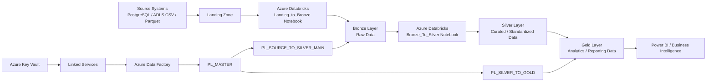

# Azure Data Engineering End-to-End Project


<div align="center">


</div>

This repository is an end-to-end Azure Data Engineering project for a healthcare/medical analytics use case. It demonstrates how to ingest, process, transform, and curate medical data using Azure Data Factory, Databricks, ADLS, Azure SQL, PostgreSQL, and analytics-ready reporting layers.

The project follows a modern lakehouse architecture, where raw data moves from source systems into a landing zone, then through Bronze, Silver, and Gold layers for downstream analytics.

## Project Overview

The objective of this project is to build a scalable and reliable data pipeline that can:

- ingest healthcare-related data from multiple source systems
- store raw files in a landing zone
- process data into a Bronze layer for raw persistence
- clean, validate, and standardize data in a Silver layer
- generate business-ready analytical datasets in Gold
- orchestrate the full workflow with Azure Data Factory

This is a practical example of how organizations can build a cloud-native, medallion-style data platform for healthcare analytics, operational reporting, and patient-centric insights.

## Business Use Case

The repository simulates a medical/healthcare domain where structured and semi-structured datasets are used for:

- patient analytics
- hospital and department-level reporting
- lab test trend analysis
- daily summary metrics
- trend detection and healthcare insights

The solution is designed to support KPI reporting and operational monitoring for healthcare teams and business stakeholders.

## Architecture

The project architecture follows a layered medallion design:



### Layered Workflow

1. Raw source data lands in the ingestion or landing layer.
2. Databricks notebooks validate and load data into the Bronze layer.
3. Bronze data is transformed and enriched in the Silver layer.
4. Gold notebooks prepare analytical tables and insights for reporting.
5. Azure Data Factory orchestrates the data movement and transformation pipeline end-to-end.

## Repository Structure

```text
AzureDataEngineer-Medical-End-To-End-Project/
├── Landing_to_Bronze.ipynb
├── Bronze_To_Silver.ipynb
├── Prepare calender table.ipynb
├── README.md
├── publish_config.json
├── dataset/
│   ├── AzureSqlTable.json
│   ├── DS_ADLS_Parquet.json
│   ├── DS_Binary_CSV.json
│   └── DS_PostgreSql.json
├── factory/
│   └── ADF-MedicalCareServices.json
├── linkedService/
│   ├── LS_ADLS.json
│   ├── LS_AzureKeyVault.json
│   ├── LS_AzureSqlDatabase.json
│   ├── LS_DatabricksMedicalProject.json
│   └── LS_PostgreSQL.json
├── pipeline/
│   ├── PL_MASTER.json
│   ├── PL_SILVER_TO_GOLD.json
│   ├── PL_SOURCE_TO_SILVER_INNER.json
│   ├── PL_SOURCE_TO_SILVER_MAIN.json
│   └── pipeline1.json
├── Gold/
│   ├── NB_hospital_daily_summary.ipynb
│   ├── NB_lab_test_trends.ipynb
│   ├── NB_patient_360.ipynb
│   └── sttm_silver_to_gold.xlsx
└── ...
```

## Key Components

### 1. Landing to Bronze Notebook
The `Landing_to_Bronze.ipynb` notebook is responsible for:

- validating the incoming landing path
- checking whether files exist
- reading CSV or Parquet files
- adding metadata such as `landing_timestamp` and `current_timestamp`
- writing the raw data into the Bronze table layer in Databricks

### 2. Bronze to Silver Notebook
The `Bronze_To_Silver.ipynb` notebook handles:

- reading Bronze data for a specific landing timestamp
- adding timestamps such as `insert_timestamp` and `update_timestamp`
- supporting `FULL`, `APPEND`, and `MERGE` loading patterns
- writing the cleaned data into Silver tables

This notebook is designed for incremental and historical data processing, which is essential for maintaining accurate healthcare records.

### 3. Gold Layer Analytics
The `Gold/` folder contains notebooks used for downstream reporting and insight generation, such as:

- hospital daily summaries
- lab test trends
- patient-level analytics

These outputs are meant for dashboards or business intelligence consumption.

### 4. Azure Data Factory Pipelines
The `pipeline/` directory contains the orchestration logic to run the project end-to-end. The main orchestration pipeline is:

- `PL_MASTER.json`

This pipeline coordinates the movement from source to Silver and then into Gold, with dependency handling between stages.

## Data Flow

A typical execution sequence in this project looks like this:

1. Source data is received from PostgreSQL or ADLS files.
2. Files are landed into a landing path in Databricks.
3. `Landing_to_Bronze` reads and writes them into the Bronze layer.
4. `Bronze_To_Silver` validates and transforms the raw records.
5. Data is persisted in Silver for analytics-ready use.
6. `PL_SILVER_TO_GOLD` and Gold notebooks create curated outputs.
7. Business dashboards and reports consume the Gold layer.

## Azure Services Used

- Azure Data Factory (ADF) — orchestration and workflow scheduling
- Azure Databricks — transformation and notebook-based data engineering
- Azure Data Lake Storage (ADLS) — raw and processed storage
- Azure SQL Database — structured data storage and analytics integration
- PostgreSQL — source system connectivity
- Azure Key Vault — secure secret and connection management
- Delta Tables — reliable transactional storage in Databricks

## Technologies

- Python
- PySpark
- SQL
- Azure Data Factory
- Azure Databricks
- Azure Key Vault
- Azure Data Lake Storage
- PostgreSQL
- Azure SQL Database
- Delta Lake

## Prerequisites

To run or extend this project, you should have:

- an Azure subscription
- Azure Data Factory configured
- Databricks workspace and cluster access
- ADLS and Key Vault access
- source system connectivity (PostgreSQL / CSV / Parquet)
- permissions to create and manage tables in Databricks

## How to Use This Repository

1. Clone the repository.
2. Review the project notebooks in the root folder.
3. Configure the linked services and secrets in Azure Key Vault.
4. Validate the source systems and landing locations.
5. Run the ADF pipelines in order:
   - source-to-silver pipeline
   - silver-to-gold pipeline
6. Use the Gold notebooks to analyze the curated datasets.

## Possible Extensions

This project can be enhanced by adding:

- automated CI/CD deployment for ADF and notebooks
- data quality checks and validation rules
- alerting and monitoring
- Power BI dashboard integration
- incremental metadata tracking and lineage
- advanced governance and cataloging

## Summary

This repository is a practical Azure-based data engineering implementation for a medical analytics use case. It demonstrates how to build a robust, scalable, and production-ready ETL/ELT architecture using Azure-native services and a medallion-style data platform.

It combines ingestion, transformation, orchestration, and reporting to provide a complete end-to-end example of modern data engineering in the cloud.

## License

This project is intended for educational and demonstration purposes. Please ensure compliance with your organization’s licensing and security policies before production deployment.
