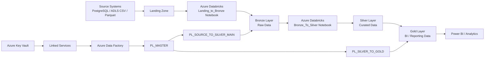

# Azure Data Engineering End-to-End Project

This repository contains an end-to-end Azure Data Engineering project focused on the healthcare and medical domain. It demonstrates how to ingest, store, transform, and curate medical data using Azure Data Factory, Azure Databricks, Azure Data Lake Storage, Azure SQL, and PostgreSQL.

The project follows a modern lakehouse-style approach where raw source data is landed, processed into Bronze and Silver layers, and then transformed into Gold analytical datasets for reporting and business insights.

## Project Objective

The goal of this project is to build a robust data pipeline that can:

- Ingest data from multiple source systems
- Store raw landing data in a controlled manner
- Process data into a consistent Bronze layer
- Clean, deduplicate, and standardize data in Silver
- Produce analytic-ready Gold datasets for healthcare reporting
- Orchestrate end-to-end execution using Azure Data Factory

## Business Use Case

This project models a healthcare analytics scenario using medical data such as:

- Hospital records
- Patient information
- Lab test results
- Clinical analytics and trends
- Daily summaries and patient-level insights

The architecture is designed to support operational reporting, patient insights, and trend analysis for healthcare stakeholders.

## Repository Overview

This repository contains the complete Azure Data Factory and Databricks implementation for the project.

### Key folders and assets

| Path | Description |
| --- | --- |
| `Landing_to_Bronze.ipynb` | Ingests raw landing files into the Bronze layer in Databricks |
| `Bronze_To_Silver.ipynb` | Reads Bronze data and loads/updates Silver tables using FULL, APPEND, and MERGE logic |
| `Prepare calender table.ipynb` | Builds a calendar table used for time-based reporting and analytics |
| `Gold/` | Contains curated analytical notebooks and outputs for metric dashboards and business summaries |
| `dataset/` | Defines dataset objects used in Azure Data Factory |
| `factory/` | Contains the ADF factory configuration |
| `linkedService/` | Stores Azure and source system connection definitions |
| `pipeline/` | Contains orchestration pipelines like master, source-to-silver, and silver-to-gold flows |

## Project Architecture

The solution follows a medallion/lakehouse architecture:

### Architecture Flow

1. Source systems provide raw healthcare data.
2. Data is landed into the ingestion layer in Azure Databricks storage.
3. `Landing_to_Bronze.ipynb` validates the files and writes them to the Bronze table layer.
4. `Bronze_To_Silver.ipynb` reads the Bronze data, adds metadata columns such as insert/update timestamps, and stores curated Silver tables.
5. `PL_SOURCE_TO_SILVER_MAIN` and related ADF pipelines orchestrate the movement and transformation from source to Silver.
6. `PL_SILVER_TO_GOLD` executes the transformation from Silver to Gold.
7. Gold notebooks produce analytical outputs for dashboards and business analysis.

## Data Processing Layers

### 1. Landing Layer
The landing layer receives incoming files from source systems. Files are checked for existence and then copied into the Bronze layer with metadata such as `landing_timestamp` and `current_timestamp`.

### 2. Bronze Layer
The Bronze layer stores raw, immutable source data in a near-original format. This layer preserves the raw data for traceability and reprocessing.

### 3. Silver Layer
The Silver layer performs data quality, standardization, and transformation tasks such as:

- handling incremental loads
- applying merge logic
- adding auditing fields
- ensuring historical correctness
- preparing clean tables for downstream reporting

### 4. Gold Layer
The Gold layer contains business-ready, analytics-optimized datasets. It is used for KPI dashboards, patient summaries, and trend analysis.

## Azure Services Used

- Azure Data Factory (ADF) for orchestration
- Azure Databricks for data engineering and transformation
- Azure Data Lake Storage (ADLS) for storage layers
- Azure SQL Database for structured data consumption
- PostgreSQL for source data integration
- Azure Key Vault for secure secret management
- Delta Lake / Databricks tables for scalable table storage

## Orchestration Details

The repository includes ADF pipeline definitions such as:

- `PL_MASTER.json` — master orchestration pipeline
- `PL_SOURCE_TO_SILVER_MAIN.json` — source-to-silver pipeline
- `PL_SOURCE_TO_SILVER_INNER.json` — inner source transformation flow
- `PL_SILVER_TO_GOLD.json` — transformation from silver to gold

The factory configuration file `factory/ADF-MedicalCareServices.json` defines the Azure Data Factory environment used by the project.

## Gold Analytics Outputs

The Gold folder contains notebooks for analytical summaries, including:

- `NB_hospital_daily_summary.ipynb`
- `NB_lab_test_trends.ipynb`
- `NB_patient_360.ipynb`

These notebooks support operational reporting and insight generation over the curated healthcare datasets.

## Example Data Flow

A typical workflow in this project is:

- Source data arrives from PostgreSQL or ADLS CSV files
- Databricks notebooks process the landing files
- Data is stored in Bronze tables
- Silver transformation applies logic and updates tables
- Gold notebooks create daily summaries and patient analytics
- Azure Data Factory coordinates the process end-to-end

## Summary

This project is a practical example of building a cloud-native healthcare data platform using Microsoft Azure services. It demonstrates how to design and implement a data pipeline that supports ingestion, transformation, data quality, orchestration, and analytics in a modern enterprise environment.

## Technologies Used

- Python
- PySpark
- Azure Databricks
- Azure Data Factory
- Azure Data Lake Storage
- Azure SQL
- PostgreSQL
- Delta Tables

## Notes

This repository is a project implementation and can be extended with:

- automated testing
- CI/CD deployment automation
- monitoring and alerting
- Power BI dashboard integration
- additional data quality rules
- advanced Medallion architecture improvements
